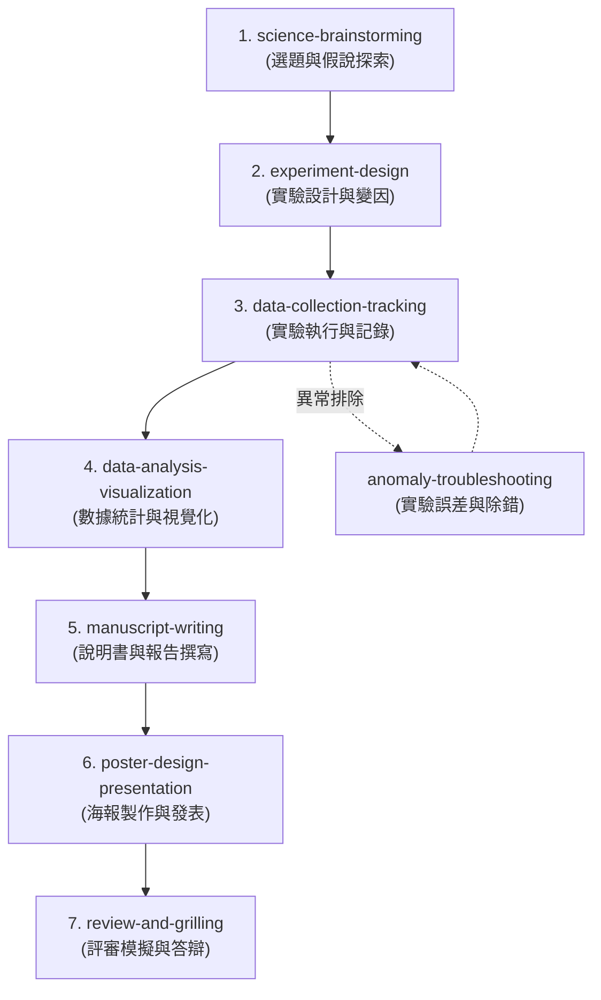

# Science Superpowers 🧪
### 師生科學探究、專題實驗與科展競賽的開發執行分析工作流程超能力

`Science Superpowers` 是一套專為 AI 助理設計的**科學探究引導工作流程與技能包**。它將軟體工程中嚴謹的計畫與驗證流程（如需求分析、計畫分解、測試驅動、代碼評審等），轉換為適合中學與大學師生進行科學專題研究、實驗設計與科展答辯的引導式方法論。

給予你的 AI 助理科學超能力，讓它不再只是提供片面的學術答案，而是成為一位具備蘇格拉底式提問精神的**科學專題教練**。

---

## 核心工作流程 🚀

Science Superpowers 將整個科學研究歷程劃分為七個關鍵階段，並引導 AI 助理在適當時機自動啟動對應技能：

### 1. 🔍 選題與假說探索 (`science-brainstorming`)
協助學生從生活觀察或學術文獻中挖掘有價值的研究題目，收斂出具體的「研究問題」，並提出可測試、可證偽的「科學假說」。

### 2. 📐 實驗設計與變因控制 (`experiment-design`)
指導學生嚴謹地區分操縱變因、應變變因與控制變因，規劃合理的對照組（陰性與陽性對照組）與實驗組，列出精確的器材規格，並撰寫具備高度可重複性的實驗步驟 (Protocol)。

### 3. 📝 數據記錄與日誌追蹤 (`data-collection-tracking`)
指引學生在實驗現場撰寫實驗日誌，設計包含多次重複試驗的結構化數據記錄表。強調數據的誠實性，記錄所有的突發狀況與異常值，並引導建立系統化的實驗影像記錄。

### 4. 📊 統計分析與數據視覺化 (`data-analysis-visualization`)
引導學生計算平均值與標準差，並為統計圖表加上誤差線。介紹雙尾 t 檢定等統計方法來驗證組間差異的顯著性 ($p < 0.05$)。輔導選擇正確的圖表類型（如連續型數據用折線圖，類別型比較用長條圖）。

### 5. ✍️ 科展說明書與小論文撰寫 (`manuscript-writing`)
引導學生按照全國科展說明書或小論文的學術格式撰寫。修正文字語氣為學術客觀風格（使用第三人稱，量化具體描述，不帶主觀形容詞），並嚴格區分「結果（事實）」與「討論（理論推論）」。

### 6. 🖼️ 海報排版與口頭發表準備 (`poster-design-presentation`)
指導學生如何將數萬字的說明書濃縮進三折板科展海報中（視覺化圖表大、字體大且少）。指導準備 1 分鐘（吸睛）、3 分鐘（主幹）與 5 分鐘（深度問答）的口頭發表稿與指圖解說技巧。

### 7. 🔥 評審模擬問答與壓力質詢 (`review-and-grilling`)
由 AI 扮演嚴格的大學教授評審，針對學生的實驗變因控制漏洞、樣本代表性不足、統計顯著性缺失、因果邏輯斷層或科學倫理安全等維度進行一問一答的模擬答辯拷問 (Grilling)，全面提升學生的思辨與臨場應變能力。

---

## 互動基本準則 💡

1. **蘇格拉底式提問**：AI 助理不直接給予學生實驗步驟、不直接幫學生寫論文，而是以提問的方式，如「如果我們改變了這個條件，你預期會觀察到什麼？為什麼？」引導學生思考。
2. **誠實與客觀**：絕不捏造數據，不縱容抄襲。強調科學研究的真實性與可重複性。
3. **安全防護優先**：在任何實驗設計討論中，主動查檢安全與廢液處置，守護師生安全。
